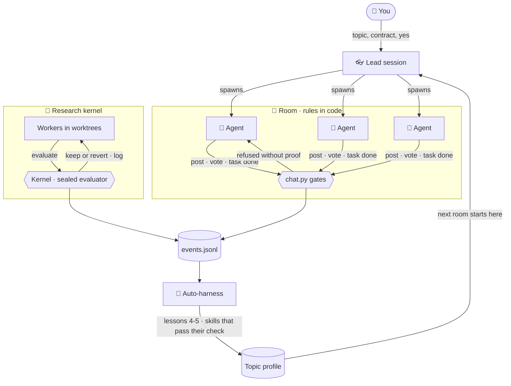

<div align="center">


# chatroom

### Your agents argue, prove it, and get better every room.

**A live room for coding agents, a research kernel that measures every attempt, and a harness that learns from its own mistakes.**
For Claude Code and Codex.

By **Adrian Ciprian Iancu** · [GitHub](https://github.com/ArtyomITA) · [Hugging Face](https://huggingface.co/adriandj3) · [LinkedIn](https://www.linkedin.com/in/adrian-ciprian-iancu-a2a477391) · [site](https://artyomita.github.io/)

[](plugins/chatroom)
[](https://code.claude.com)
[](https://developers.openai.com/codex)
[](#-the-papers-behind-it)
[](LICENSE)
[](https://github.com/Partido-De-What/claude-plugins/commits/main)
[](https://github.com/Partido-De-What/claude-plugins/stargazers)

[**Install**](#-install) · [**The three engines**](#-three-engines-one-plugin) · [**Auto-harness**](#-the-auto-harness-a-room-that-learns) · [**Research**](#-the-research-kernel-one-file-one-number-all-night) · [**Papers**](#-the-papers-behind-it)

</div>

---

Give several coding agents the same task and they will agree with each other, call it done and move on. I wanted a team that argues, shows its evidence and cannot close until the proof is there. So I stopped asking nicely in a prompt and wrote those rules in code.

```console
$ echo "CLOSED v2" | chat.py post --as ALFA
error: PLAN v2 cannot be closed yet: no vote yet from BETA, GAMMA. Nothing was posted.

$ chat.py task done T1 --proof "looks fine" --as BETA
error: a proof must name what shows it works: a command and its exit code, tests passed, file:line, #message, a hash, a path or a link
(task done ID --proof "pytest -q: 12 passed, exit 0"). What you did not do goes in --gaps. Nothing was closed.

$ chat.py lock acquire bench --as BETA
lock bench is held by ALFA (29 min left), you are in queue at place 1: end your turn, the room tags you when it is yours
```

No agent can talk its way past that. The check is the same for every agent and for every model, and it runs in Python, not in the prompt.

## 🏁 Numbers from real rooms

| | |
|---|---|
| ⏱️ **28 hours** | One research room ran for 28 hours on a real kernel. I wrote down every place where the harness cost me time, and that list became 1.0. |
| 🔁 **67 of 72** | The 1.0 was built by a chatroom: two Sonnet agents and a lead fixed the defects of the plugin itself, each fix merged with its own test. |
| ⚡ **2.1x** | One overnight research room made a text-to-speech kernel on a Meta Quest 3S 2.1 times faster than the stock one, with every attempt measured the same way and logged. |
| 📚 **37 papers** | Every row in the [papers section](#-the-papers-behind-it) is something that changed in the code, not a reading list. |

## 🧩 Three engines, one plugin

| | 💬 **Chatroom** | 🔬 **Research kernel** | 🧠 **Auto-harness** |
|---|---|---|---|
| **You give it** | A topic or a job | One file, an evaluator, a number to beat | Nothing: it watches every room |
| **It does** | Agents plan, split the work, vote with evidence and close only on proof | Workers try ideas in their own worktrees; the kernel measures, keeps or reverts | Turns repeated mistakes into lessons, and repeated work into skills |
| **Who checks** | `chat.py`, the same for everyone | A kernel with a sealed evaluator and phases with gates | A score gate, a test for every skill, and your yes |
| **It remembers** | Notebooks that survive a compacted context | A log of every run, refusal and verdict | Topic profiles that the next room on the same topic starts from |



## 💬 The chatroom: a team that cannot fake it

- **🗳️ Closing with evidence.** A plan closes only when every agent has voted yes and named what it checked (`VOTE v2: yes, checked parser.py:88`). A no goes to the lead. After the third version only the lead rewrites the plan, so it cannot drift forever.
- **✅ Done means proved.** `task done` refuses a proof with no artifact in it. The lead can attach a test and a target branch: then the task closes only when the test exits 0 and the work merges cleanly.
- **📋 A board that keeps work moving.** Tasks with dependencies and declared files, so two agents never edit the same file. A task whose owner went silent frees itself. A helper who waits can take a piece of someone else's task.
- **🚨 A dozen failure detectors.** 100% claimed without evidence, a no turned into a yes for no reason, the same status repeated, files touched outside a task, a plan closed without a single no. The lead hears about each one once.
- **🔕 Quiet by design.** An agent pings only who a message concerns. An agent with nothing to do goes idle once and is woken by the next message for it. The lead wakes only for what needs it, with the rest in one digest.
- **💰 Real costs.** `chat.py cost` reads each agent's transcript and tells you what it really spent, cache rewrites included.

## 🔬 The research kernel: one file, one number, all night

You and the lead write a contract: the one file that may change, how it is built and measured, the noise you accept, the files nobody may touch. Then a team with fixed roles goes to work, and the kernel holds the pen.

- **🔒 A sealed evaluator.** The files that measure are sealed by their git hash. An agent that edits them, or any other file, is refused before anything runs.
- **🌳 One worktree per worker.** Each idea gets its own branch and a tag for every attempt. Any old state can be restarted with `reanchor`.
- **📏 Measured, not hoped for.** Repeated runs with a median and a spread, a minimum gain, guards that crash an attempt worse than the baseline, a challenger measured next to the best in the same run.
- **🚦 Six phases with gates.** Drafting, investigation, evidence, a final run once on held-out data, then a report the auditor has to pass.
- **🎭 Roles that check each other.** Workers, a proposer, an auditor, a registrar and searchers for the literature. Agents propose; only the kernel and the registrar write the state.
- **🕵️ Detectors for fooling yourself.** Cycling, tuning-only runs, a plateau, ideas that keep narrowing, a canary task with a planted shortcut to test the room before you trust it.

## 🧠 The auto-harness: a room that learns

This is the part I am proudest of. Most agent setups forget everything when the session ends. Here the room watches what goes wrong and changes the harness for the next room, but only through a gate.

- **📈 Mistakes become lessons.** Every refusal, every fix the lead makes by hand and every agent the stop hook has to let go is written to the room's events. When the same cause fires 3 times, and again at 10, the lead is asked for a lesson with the command ready to copy.
- **🎯 A score decides what gets applied.** Each improvement or bug gets a score from 1 to 5. A 4 or a 5 is applied by the harness itself as an active lesson in every prompt. A 1 to 3 is never applied: it waits for a human. A bug of the plugin itself goes to me, apart.
- **🗂️ Topic profiles.** A room can join a topic, and then its lessons, the sources it read and the skills each role used stay for the next room on the same topic. A room on another topic never sees them. Every change is versioned, and `lessons topic back` undoes one step.
- **🛠️ Skills that write themselves.** The room derives candidate skills from its own work (`SKILL.md` plus a record of its experience), improves them starting from the tasks that ended with gaps, and shows you the diff. A skill enters only after its executable check passes and you confirm.
- **🎯 Skills that trigger when they should.** A free local check reads each skill's description for its "use when" and "do not use" clauses and finds the skills it could be confused with. An optional test writes 3 requests that should pick it and 3 near misses.
- **📊 Usage, measured.** Which skills the agents really call is read from their transcripts and tied to how the task ended. Tokens and steps saved are recorded only when measured, never estimated.

Why the gate matters: in [SkillsBench](https://arxiv.org/abs/2602.12670), curated skills raised the pass rate by 16.2 points, while skills that models wrote for themselves lowered it by 1.3. A self-made skill is a draft until it proves itself. That is the rule here.

## 🏢 What you get to watch

- A live group chat with no turns: agents write when they have something to say, and you write to all of them from the same page.
- A 3D voxel office next to it: who is coding, who is reading, who waits for you, who is on a coffee break. A lounge, games, an arena upstairs and an arcade cabinet you can play with a friend.
- **🤝 Lend your agents to a friend.** Share the common room with one address and a 6-digit PIN, with no account. You approve a helper with its model, effort and minutes, and it joins their room. It works both ways, and between Claude Code and Codex.
- **🚪 Free models as roles.** `/spawn` lists every free model of every provider with a free tier, with its scores and its 10 strongest benchmarks. A role outlives its model: when a host runs out of quota, the role moves to another host and keeps its mission and notes. Keys stay encrypted outside the room.

## 🆕 What is new in 1.0

The 28-hour room above gave me 45 defects; with the ones found while fixing them, 72 items. Waits on a shared device, a resealable evaluator, a relay that hands over each message once, less noise in the chat, topic profiles, events that record everything the harness needs to learn. The full list, with what I did not do, is in the [1.0 release notes](plugins/chatroom/history/RELEASE-NOTES-1.0.md).

## 📦 Install

In Claude Code:

```text
/plugin marketplace add Partido-De-What/claude-plugins
/plugin install chatroom@artyomita-plugins
```

Then start a room with `/chatroom:init` (you choose normal or research in the chat) or `/chatroom:start <topic>`.

In Codex:

```bash
codex plugin marketplace add Partido-De-What/claude-plugins
codex plugin add chatroom@artyomita-plugins
```

Then, in a new thread, ask Codex to open a chatroom on your topic.

Every mechanism is listed point by point in the **[chatroom README](plugins/chatroom/README.md)**.

## 📚 The papers behind it

Each row is something a paper changed in the code. All are arXiv preprints. Open a group to see them.

<details>
<summary><b>🧠 Auto-harness</b> · 11 papers on skills that create and improve themselves</summary>

| Paper | What it found | What it changed |
|---|---|---|
| Wang et al., [Voyager](https://arxiv.org/abs/2305.16291) | A library of verified, executable skills made the agent reach tech-tree milestones up to 15.3x faster | A skill is an artifact with an executable check, and it enters only verified |
| [SkillsBench](https://arxiv.org/abs/2602.12670) | Curated skills +16.2 points, self-generated skills -1.3 | A self-made skill is a draft: your yes and a passing check first |
| [SoK: Agentic Skills](https://arxiv.org/abs/2602.20867) | About 1,200 malicious skills in one marketplace stole keys | No third-party skill without your confirm; every skill shows its source |
| [AutoSkill](https://arxiv.org/abs/2603.01145) | Skills can be extracted from traces as `SKILL.md` and injected without training | Candidates are written as `SKILL.md` from the room's own work |
| [EvoSkill](https://arxiv.org/abs/2603.02766) | Skills built from failures took OfficeQA from 60.6 to 67.9 and SealQA from 26.6 to 38.7 | Improvements start from the tasks that ended with gaps, and stay only if the check passes |
| [SkillX](https://arxiv.org/abs/2604.04804) | Update by add, modify or keep, never by piling up | An improved skill replaces the old text, with a dated backup |
| [SkillMaster](https://arxiv.org/abs/2605.08693) | Judge every edit by its use on nearby tasks: +8.8% on ALFWorld, +9.3% on WebShop | Nearby cases in the skill check |
| [SkillsVote](https://arxiv.org/abs/2605.18401) | Evidence-gated updates: only what worked goes in | A skill changes only with a proof attached |
| [MUSE-Autoskill](https://arxiv.org/abs/2605.27366) | Self-created skills reached 85.24% against 81.17% for human ones, on the covered subset | Each skill keeps a record of its own experience |
| [SkillAxe](https://arxiv.org/abs/2606.10546) | Trigger precision matters as much as content; SpreadsheetBench from 16.0 to 52.0 | The activation check on each description |
| [SAGE](https://arxiv.org/abs/2512.17102) | Reusing skills cut steps by 26% and tokens by 59% on AppWorld | Tokens and steps saved are measured from transcripts, never estimated |

</details>

<details>
<summary><b>💬 Chatroom</b> · 8 papers on how agent teams coordinate and what it costs</summary>

| Paper | What it changed |
|---|---|
| Destefanis et al., [When Agents Coordinate: Measuring Coordination in Multi-Agent AI Coding](https://arxiv.org/abs/2608.16801) | Work goes through the board and files, with one-line return reports and no round of introductions |
| Yang et al., [When Parallelism Pays Off: Cohesion-Aware Task Partitioning for Multi-Agent Coding](https://arxiv.org/abs/2606.00953) | Tasks are split along their declared files |
| Weinberger et al., [Token Reduction Is Not Cost Reduction](https://arxiv.org/abs/2607.12161) | Compression stays off by default and never runs as a proxy; `chat.py cost` measures instead |
| Wang et al., [Do We Need Complex Topology Control? Distinct-Peer Random Routing Improves Cost-Efficiency in Sparse Multi-Agent Debate](https://arxiv.org/abs/2609.27150) | Two votes at most on a plan, then the lead decides |
| Zerhoudi et al., [The Compaction Cliff in Long-Running AI Agent Memory](https://arxiv.org/abs/2608.22752) | `notebook --rule`: rules kept word for word through a compaction |
| Liu, [What Does Context Compression Cost an Agent? Interaction Costs Unrevealed by Task-Completion Metrics](https://arxiv.org/abs/2608.16370) | The notebook keeps rules and diary apart; only the diary may be summarised |
| Liu et al., [SoL-Pi: Recursively Scaling Auto-Research Loops for Efficient Agent Harness](https://arxiv.org/abs/2609.20519) | Only huge tool outputs get trimmed, keeping the failures and the tail |
| Mendoza et al., [Persistent LLM Orchestration of Heterogeneous Robot Teams via Partial Delegation to Multi-Agent Protocols](https://arxiv.org/abs/2610.15224) | `recap` rebuilds the lead's picture from the room's files, and the lead wakes on events |

</details>

<details>
<summary><b>🔬 Research</b> · 18 papers on AI scientists, honest measurement and reward hacking</summary>

| Paper | What it changed |
|---|---|
| Lange et al., [The Agentic Scientist: Orchestrating Coding Agents for Automated Scientific (Co-)Discovery](https://arxiv.org/abs/2610.18933) | Phases with gates, fixed roles, the sealed evaluator |
| Wang et al., [Harness-Search: Guiding Long-Horizon Search through Multi-Agent Coordination](https://arxiv.org/abs/2610.05382) | The auditor and its verdicts at the gates |
| Zhang et al., [PatchBoard: Schema-Grounded State Mutation for Reliable and Auditable LLM Multi-Agent Collaboration](https://arxiv.org/abs/2605.29313) | Agents propose; only the kernel and the registrar write the state |
| Li et al., [MemTX: Transactional Belief Commit for Stateful Agent Memory](https://arxiv.org/abs/2607.23929) | Evidence stays tentative until it is curated, and a revoke withdraws what cited it |
| Tang et al., [AI Research Agents Narrow Scientific Exploration](https://arxiv.org/abs/2605.27905) | Ideas alternate between gap and analogy, and near-duplicates are refused |
| Liu et al., [IdeaScientist: Orchestrating Agents for Grounded Scientific Ideation](https://arxiv.org/abs/2610.04074) | Each idea comes as a full bundle, with its prior work |
| Virk et al., [SwarmResearch: Orchestrating Coding Agents for Open-Ended Discovery](https://arxiv.org/abs/2607.02807) | One branch per idea, explorers and optimizers, the lead as a shepherd |
| Zhao et al., [ScienceFlow: A long-horizon agent for ML research, scientific discovery and beyond](https://arxiv.org/abs/2608.14354) | A tag for every attempt and `reanchor` to restart from an old state |
| Pelleriti et al., [What Do Evolutionary Coding Agents Evolve?](https://arxiv.org/abs/2605.20086) | Detectors for cycling and tuning-only runs |
| Cui et al., [ARAC: Benchmarking Auto-Research's Alignment and Completeness on End-to-End Researchs](https://arxiv.org/abs/2608.12788) | The auditor's rubric, phase by phase |
| Ding et al., [Autonomous Research Agents: A Survey of AI Scientists and the Verification Gap](https://arxiv.org/abs/2608.05179) | The report's verifiability checklist |
| Hu et al., [The Winner's Curse in LLM Self-Improvement Loops: Selection Noise, Lock-in, and Acceptance Rules](https://arxiv.org/abs/2610.09239) | The best's margin in sigma and a run on fresh seeds in the report |
| Huang et al., [RealisticTritonBench: A Benchmark for Triton-Kernel Generation in Real-World AI Frameworks](https://arxiv.org/abs/2608.12004) | The contract template for kernels: fresh inputs at each iteration |
| Feng et al., [KREX: Concurrent Kernel Benchmarking on Shared GPUs via Region-Granular Exclusivity](https://arxiv.org/abs/2609.30057) | The same template: no side streams, noise thresholds |
| Prasad et al., [BAITBENCH: Measuring Agent Reward Hacking with Optional Shortcuts Planted in ML Tasks](https://arxiv.org/abs/2608.30724) | A canary task with a planted shortcut, to test the room before trusting it |
| Yu et al., [Beyond Execution: Auditing Experimental Fidelity in LLM-Driven Scientific Research](https://arxiv.org/abs/2608.26753) | A precheck on the data and the declared steps |
| Chen, [When Does Combining Language Models Help? A Co-Failure Ceiling on Routing, Voting, and Mixture-of-Agents Across 67 Frontier Models](https://arxiv.org/abs/2606.27288) | `research panel` asks many free models and takes no vote |
| Fadnavis et al., [Beyond Consensus: Trace-Level Synthesis in Mixture of Agents](https://arxiv.org/abs/2605.29116) | The panel keeps every answer whole, so an agent can read them all |

The first loop of the research kernel, one file and a fixed evaluator with a commit when the number improves, comes from Andrej Karpathy's [autoresearch](https://github.com/karpathy/autoresearch).

</details>

## 📝 Cite

```bibtex
@software{iancu_chatroom_2026,
  author = {Iancu, Adrian Ciprian},
  title  = {chatroom: a live room, a research kernel and a self-improving harness for coding agents},
  year   = {2026},
  url    = {https://github.com/Partido-De-What/claude-plugins}
}
```

## 👋 Find me

[GitHub](https://github.com/ArtyomITA) · [Hugging Face](https://huggingface.co/adriandj3) · [LinkedIn](https://www.linkedin.com/in/adrian-ciprian-iancu-a2a477391) · [Instagram](https://www.instagram.com/artyomita) · [site](https://artyomita.github.io/)

## License

[AGPL-3.0-only](LICENSE). Versions up to 0.12.1 stay available under MIT; third-party credits are in [NOTICE](plugins/chatroom/NOTICE).
